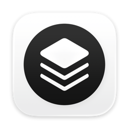

<h1 align="center">ImageKit</h1>

<p align="center">
  
</p>

<p align="center">
A Mac app, command line tool, and MCP server that make PNG, JPEG, AVIF, SVG, and PDF files smaller without changing how they look, and turns Illustrator logos into PDF or SVG. Drop files or folders on it, or right-click a file in Finder, and compare the result with the original before you keep it. Everything runs on your Mac; nothing is uploaded.
</p>

<p align="center">
  
</p>

<p align="center">
  <a href="https://github.com/tretten/imagekit/releases/latest/download/ImageKit.dmg">
    
  </a>
</p>

## Features

- Two modes, switched at the top left (⌘1 and ⌘2): Raster for PNG, JPEG, and AVIF, Vector for SVG, PDF, and Illustrator (AI) files. Dropping files of the other kind switches the mode for you.
- Compresses PNG, JPEG, and AVIF. PNGs are reduced to a palette with the fewest colors that still match the original, then packed with Zopfli. JPEGs are re-encoded with mozjpeg at the lowest quality that keeps the picture alike, and never end up larger than a lossless rewrite of the same file; EXIF, GPS, and other tags stay unless you turn Remove camera and location data on. AVIF uses the system encoder, held to the same checks as JPEG.
- Vector: SVG files lose metadata, editor data, comments, and empty groups, and get shorter numbers and paths, checked against a render of the original. PDF files get their images recompressed at the JPEG quality and resolution you pick, with text, links, and bookmarks kept. SVG converts to PDF (paths stay vector; filters such as shadows are left out and the row says so), and PDF converts to SVG from its first page.
- Illustrator (AI) files convert to PDF (artboard and transparency kept, private Illustrator data dropped) or to SVG for the web, with an option to crop the empty margin around the artwork. The SVG conversion covers paths, strokes, gradients, clipping, and CMYK and spot colors, and a note on the row says what it could not carry over, such as live text. Outline the text in Illustrator first.
- Three quality levels, Smaller, Balanced, and Closest, shared by both modes: they set the PNG, JPEG, and AVIF checks, the digits kept in SVG, and the picture quality in PDF (75, 85, and 95).
- Compress Again: change a setting and run the last batch again from the originals. A result in another format stays beside the new one.
- Keeps each file's format, picks the smaller of PNG and JPEG per file, or converts everything to PNG, JPEG, or AVIF. JPEG XL (under More…) turns JPEGs into smaller files without changing a pixel, and the original JPEG can be rebuilt from it; not every app opens JPEG XL yet.
- Limits the longest side of large images (1024, 2048, 2560, or 4096 px), and removes camera and location data from JPEGs. A photo saved sideways is rotated upright first.
- Safe by default: the result is saved beside the original with a suffix you choose (`-min`). Or it replaces the file and the original goes to the Trash or to an `.originals` folder. Undo puts the last batch back.
- Before and after preview with a draggable slider, a Fit view, and zoom to 100%, 200%, 400%, and 800% (or pinch) that you can pan, so you can judge the quality at real pixels. Arrow keys step through the batch.
- Folders and batches: a dropped folder or more than ten files waits in a list until you press Compress. Files run in parallel on all cores, each row fills as it progresses, and Stop cancels the rest.
- Ways in: drag onto the window or the Dock icon, Choose…, the Finder right-click menu (Quick Actions › Compress with ImageKit), a global shortcut that compresses what is selected in Finder (⌥⌘K by default, configurable), and the menu bar icon.
- Works in the background: files dropped on the menu bar icon, sent by the shortcut or by the Quick Action are compressed with your settings without opening the window, the menu bar icon shows the progress as a percentage, and a notification says what was saved.
- Lives in the menu bar: the Dock icon is there while the window is open and goes away when you close it.
- Marks the files it makes, and compresses them again whenever you ask, in any format. A lossy file loses a little more each pass, so the original is the better source.
- Command line tool and MCP server for scripts and coding agents, in the same app (see below). Settings › Agents adds the MCP server to Claude Code, Claude Desktop, Codex, Gemini CLI, Cursor, Windsurf, or OpenCode with one click, after showing what it will write.
- Checks for updates with Sparkle, daily and on every launch.

<p align="center">
  <br>
  
</p>

## Privacy

Runs entirely on your Mac. No analytics, no uploads. The only network connection is Sparkle's update check (daily and on every launch). The shortcut asks macOS once for permission to read Finder's selection. The right-click menu needs no permission.

## Install

Download the latest DMG from [Releases](https://github.com/tretten/imagekit/releases), drag ImageKit to Applications, and open it. Builds are signed and notarized. Requires macOS 14 (Sonoma) or later on a Mac with Apple silicon.

Or with Homebrew, which also puts `imagekit` on your PATH:

```sh
brew install --cask tretten/imagekit/imagekit
```

To get the right-click menu, open System Settings › Extensions › Finder (or Quick Actions) and turn on **Compress with ImageKit**.

## Command line

The command line tool is part of the app: `ImageKit.app/Contents/Helpers/imagekit`. Get it on your PATH one of three ways: Homebrew (above), the **Install** button in Settings › General (links `/usr/local/bin/imagekit`), or call it by its full path. It is signed and notarized with the app and updates with it.

```sh
imagekit photo.png                    # photo-min.png beside the original
imagekit --to avif *.png              # convert to AVIF
imagekit --level smaller --max 2048 photos/     # a folder, recursive
imagekit --replace photo.jpg          # replace it; the original goes to .originals
imagekit --output-dir out/ *.jpg      # results into out/, originals untouched
imagekit --dry-run folder/            # say what would happen, write nothing
imagekit --inspect photo.heic         # format, pixel size, alpha, animated
imagekit --diff before.png after.png  # how alike two pictures are
imagekit --json photo.png             # machine-readable
imagekit --capabilities               # JSON: every option with default and range
imagekit --help
```

Takes PNG, JPEG, AVIF, SVG, PDF, AI, and (read-only) HEIC and GIF. HEIC and GIF become PNG, JPEG, or AVIF; animated GIF, PNG, and AVIF are left as they are. A file ImageKit already made is compressed like any other, and each lossy pass loses a little more.

### Flags

| Flag | Meaning |
|---|---|
| `--level smaller\|balanced\|careful` | One setting for all formats (default `balanced`; `closest` is an alias for `careful`). Sets the picture checks, SVG digits, and PDF quality; the flags below override it. |
| `--to png\|jpg\|avif\|jxl` | Raster files become this format; `jxl` is lossless and takes JPEGs only. Without it each file keeps its format. |
| `--convert` | Per file, the smaller of PNG and JPEG when clearly smaller. |
| `--to pdf\|svg` | Vector files become this format (SVG to PDF, PDF to SVG, AI to PDF or SVG). |
| `--max N` | Longest side in pixels; smaller pictures are not enlarged. `0` keeps (default). |
| `--strip` | Drop EXIF (with GPS), IPTC, XMP, and comments from JPEGs. Kept by default. |
| `--suffix S` | Added to the result name (default `-min`; not empty, no `/` or `..`). |
| `--replace` | The result takes the file's name; the original moves to `.originals` beside it. Wins over `--suffix`. |
| `--output-dir DIR` | Results go here (created if missing). Not with `--replace`. |
| `--quality Q`, `--tolerance T`, `--blocking B` | Fine control of the checks: SSIM target 0...1, PNG palette error budget 0...1, JPEG block-staircase budget 0...1. |
| `--effort N`, `--dither`, `--no-dither` | PNG: Zopfli passes 0...15 (default 3); error diffusion (default on). |
| `--svg-precision N` | Digits kept in SVG coordinates, 1...3. |
| `--pdf-level L`, `--pdf-dpi N` | PDF picture quality (`smaller\|balanced\|closest`) and the DPI above which images scale down (`0` keeps). |
| `--no-crop`, `--pdf-crop` | `--no-crop`: SVG made from PDF or AI keeps the whole page. `--pdf-crop`: a PDF made from AI is cut to the drawing. |
| `--dry-run` | Detect and report; write nothing. |
| `--inspect` | Report what each file is; encode nothing. |
| `--json` | NDJSON on stdout: one object per file as it finishes, then `{"summary": ...}`. |
| `--timeout SECONDS` | Per file. On expiry that file fails and the rest go on. |
| `--diff a b` | Compare two pictures of the same size (add `--json` for an object). Must be the first argument. |
| `--capabilities`, `--version`, `--help` | |

Anything unknown, out of range, or missing a value is an error on stderr, never silently ignored.

### Exit codes

| Code | Meaning |
|---|---|
| 0 | Every file done or unchanged |
| 1 | At least one file failed |
| 2 | Bad flags or paths |
| 3 | Nothing to process |
| 130 | Interrupted (Ctrl-C or SIGTERM); nothing is left half-written |

### JSON output

`imagekit --json photo.png` prints one line per file, then a summary:

```json
{"source":"/Users/me/photo.png","output":"/Users/me/photo-min.png","state":"done","before":1255328,"after":242489,"saved":1012839,"savedPercent":80.68,"seconds":5.36}
{"summary":{"done":1,"unchanged":0,"failed":0,"bytesBefore":1255328,"bytesAfter":242489,"files":[...]}}
```

`state` is `done`, `unchanged`, or `failed`. `reason` explains the last two, `note` carries a caveat (for example "Only the main image was kept."), and `backup` is the moved original when `--replace` was used. Paths are absolute. Sizes are bytes.

`imagekit --inspect --json photo.png` reports `format`, `widthPx`, `heightPx`, `bytes`, `hasAlpha`, `animated`, `stampedByImageKit`, `supported`, and `wouldBecome`. `imagekit --diff --json a b` reports `rmse`, `psnr`, `ssim`, `banding`, `blocking`, `contours`, `smoothError`, `darkHue`, `colourCast`, and a one-line `verdict`.

## Use with AI agents (MCP)

The same binary is an MCP server (stdio), so a coding agent can compress, inspect, and compare images itself. If you are an agent, [AGENTS.md](AGENTS.md) is the short version of this section.

Add it to your client (use the full path: GUI clients often lack your PATH):

```sh
# Claude Code
claude mcp add imagekit -- /Applications/ImageKit.app/Contents/Helpers/imagekit mcp

# Codex
codex mcp add imagekit -- /Applications/ImageKit.app/Contents/Helpers/imagekit mcp
```

Any other MCP client (Cursor, Windsurf, Claude Desktop, and so on): the command is `/Applications/ImageKit.app/Contents/Helpers/imagekit` with the single argument `mcp`:

```json
{
  "mcpServers": {
    "imagekit": {
      "command": "/Applications/ImageKit.app/Contents/Helpers/imagekit",
      "args": ["mcp"]
    }
  }
}
```

Or skip the config files: Settings › Agents lists the clients found on your Mac. Add shows the file and the entry first, keeps the old file beside it as `<name>.imagekit-backup`, and leaves a config it cannot read alone. Update fixes the path after you move the app, Remove takes the entry out, and Copy gives the usual `mcpServers` JSON for any other client.

If you installed with Homebrew or the Settings button, `imagekit` on its own works as the command too.

### Tools

| Tool | Arguments | Returns |
|---|---|---|
| `compress` | `paths` (required, files or folders); optional `level` (`smaller\|balanced\|careful`), `target` (`same\|smart\|png\|jpeg\|avif\|jxl\|pdf\|svg`), `max_side`, `strip_metadata`, `suffix`, `output_dir`, `replace`, `svg_precision`, `pdf_dpi`, `crop_to_artwork`, `confirm_batch` | per file: `source`, `output`, `state`, `before`, `after`, `saved`, `savedPercent`, `note`, `backup`; plus totals |
| `inspect` | `paths` | per file: format, size in pixels and bytes, alpha, animated, already compressed by ImageKit, what it would become |
| `diff` | `original`, `result` | RMSE, PSNR, SSIM and six more checks, plus a one-line verdict |
| `capabilities` | none | formats, levels, every option with default and range |
| `undo` | `items`: the `source`, `output`, and `backup` values from a `compress` result | per item: restored or failed. Works after a server restart; removes only files ImageKit made |

A good order: `inspect` to see what you have, `compress` with the default level, `diff` when the result matters, `undo` if you do not like it. Pick `level: "careful"` for photos where quality matters most, `"smaller"` for thumbnails and throwaways.

### Safety rules the server enforces

- Originals are never replaced unless `replace: true`. Then the original moves to `.originals` beside the file, never the Trash and never deleted.
- A folder, or more than 50 files, is refused unless `confirm_batch: true`; the error tells you the count. After 200 files have gone through in one session without it, every call needs it.
- `/`, the home folder, `~/Library`, and the insides of `.app` bundles are refused. Symlinks are resolved first.
- One batch at a time. A second `compress` while one runs returns "busy".
- Failures come back as a normal result with `isError: true` and a message, not as a protocol error.

## Updates

ImageKit checks for updates with Sparkle, and the command line tool and MCP server inside the app update with it. A Homebrew install is kept current by the app itself; `brew upgrade --cask imagekit` also works.

## Third-party software

ImageKit includes [Zopfli](https://github.com/google/zopfli) (Apache 2.0), [mozjpeg](https://github.com/mozilla/mozjpeg) (IJG, BSD, and zlib licenses), and [Sparkle](https://sparkle-project.org) (MIT). The full notices are in the app under Settings › About.

---

This repository holds only signed release builds (DMG/ZIP) for the auto-update feed. It does not contain source code.
